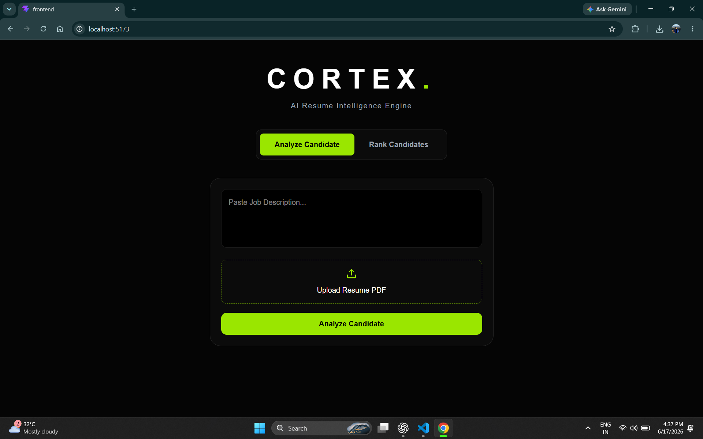
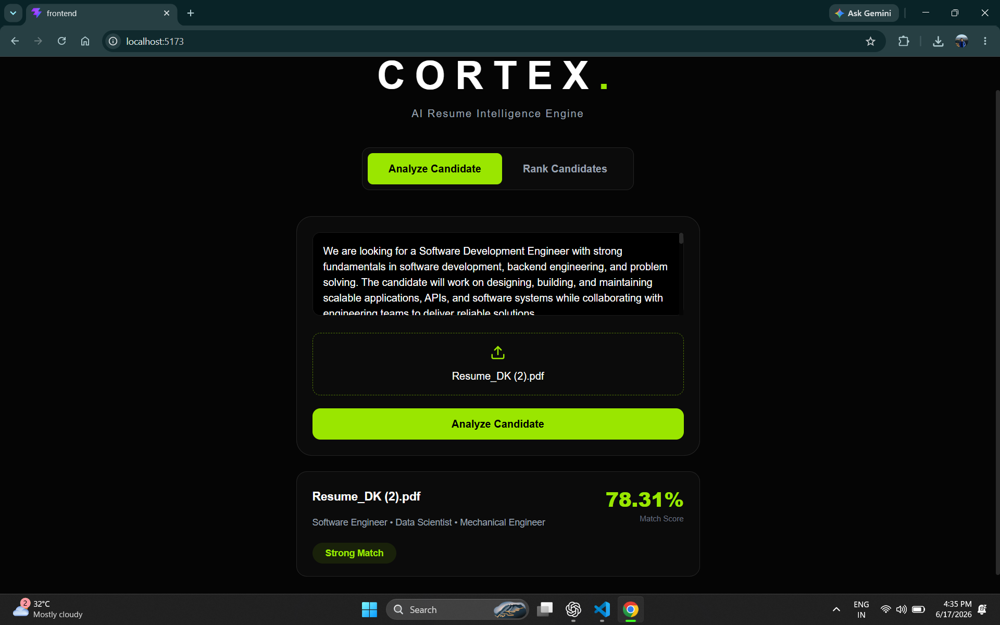
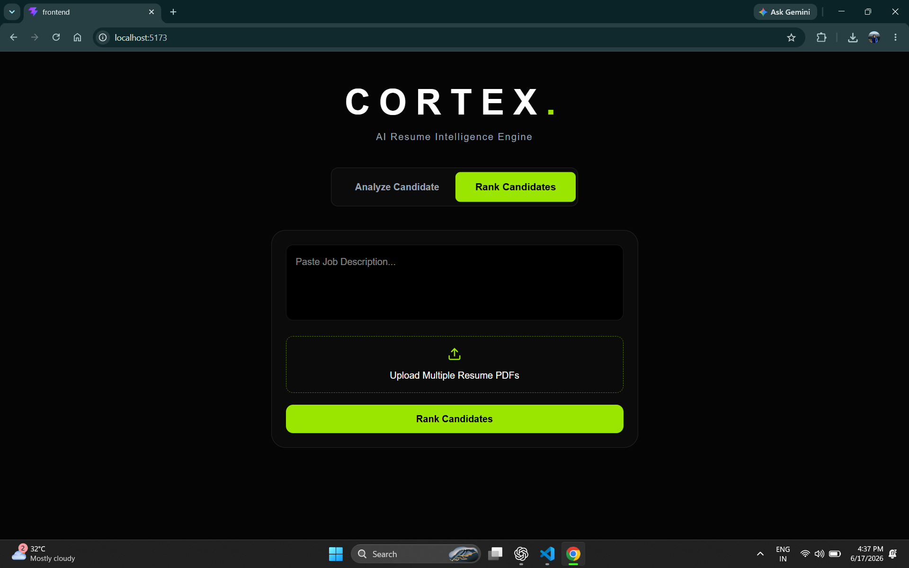
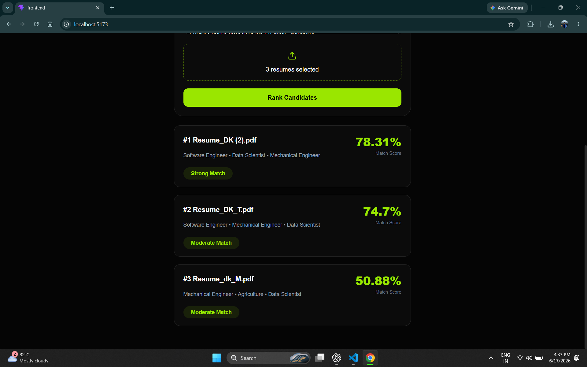

# Cortex - Machine Learning Based Resume Screening and Ranking System

Cortex is a full-stack machine learning application that automates resume screening by analyzing resumes against job descriptions. It uses Natural Language Processing, ML classification, and Sentence Transformer embeddings to generate compatibility scores and rank candidates.

## Features

- Extracts text from PDF resumes
- Predicts resume category using trained ML models
- Performs semantic resume-job matching using Sentence Transformers
- Generates compatibility score using cosine similarity
- Ranks candidates based on job relevance
- Provides REST APIs using FastAPI
- Interactive frontend built with React.js

## Tech Stack

**Frontend**
- React.js
- JavaScript
- Axios
- CSS

**Backend**
- Python
- FastAPI

**Machine Learning / NLP**
- Sentence Transformers
- Scikit-Learn
- PyTorch
- TF-IDF Vectorization
- Cosine Similarity
- Pandas
- NumPy

## Screenshots

### Resume Analysis Page

### Resume Analysis Result

### Resume Ranking Page

### Ranking Result

## Project Highlights

- Built an end-to-end ML pipeline for resume analysis and ranking
- Integrated transformer-based semantic understanding for better matching
- Developed APIs for model inference and resume processing
- Combined traditional ML classification with modern NLP techniques

## Future Improvements

- Advanced ATS scoring
- Resume improvement suggestions
- Skill extraction
- Recruiter dashboard

## Author

Deepraj Kashyap  
Electronics and Communication Engineering  
National Institute of Technology Silchar